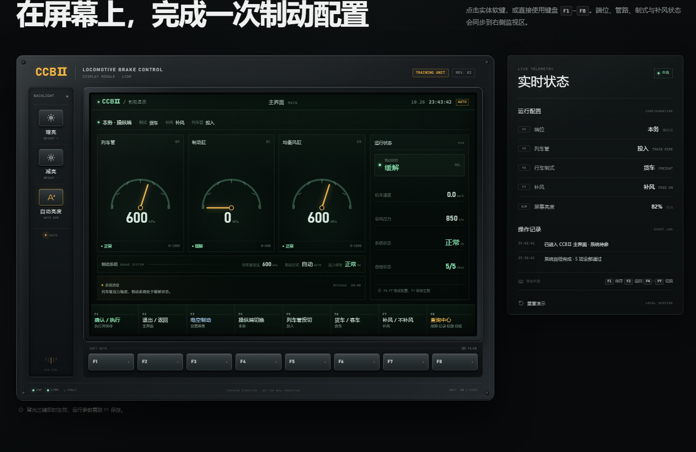

# LCDM · CCBⅡ 机车制动显示器

一个可直接运行的 LCDM 交互演示网站：工业 HMI 机身、CCBⅡ 主界面、8 个页面自适应软键，以及屏幕左侧 3 个背光调节键。



## 快速开始

直接双击 `index.html` 即可，无需安装依赖。也可以在当前目录启动静态服务器：

```bash
python -m http.server 8000
```

然后访问 `http://localhost:8000`。

页面不引用外部字体、图片、图标库或脚本。

## 目录结构

```text
.
├─ index.html                 页面结构与可访问性标记
├─ README.md
├─ .gitignore
├─ .nojekyll                   GitHub Pages 静态发布标记
├─ assets/
│  ├─ css/styles.css         工业 HMI 视觉、屏幕组件、响应式布局
│  └─ js/app.js              按键状态机、页面切换、自检与背光逻辑
└─ preview/
   ├─ console.png            主终端预览
   └─ hero.png               首屏预览
```

## 主界面软键

| 按键 | 功能 | 行为 |
| --- | --- | --- |
| F1 | 确认 / 执行 | 保存待确认配置；没有待保存项时执行状态确认 |
| F2 | 退出 / 返回 | 设置页返回主界面并放弃修改；主界面放弃待确认项 |
| F3 | 电空制动 | 进入电空制动设置菜单 |
| F4 | 操纵端切换 | 本务（操纵端）↔ 补机（非操纵端） |
| F5 | 列车管投切 | 投入 ↔ 切除；压力表与状态栏同步变化 |
| F6 | 货车 / 客车 | 切换行车制式；正常行车默认货车 |
| F7 | 补风 / 不补风 | 切换列车管补风模式 |
| F8 | 故障 · 记录 · 标定 · 自检 | 打开查询中心 |

进入设置页或查询页后，屏幕底栏的软键文字会自动切换，始终与下方 8 个实体键一一对应。

## 状态规则

1. F4–F7 的切换会立即显示预览，但以琥珀色标记为“待确认”。
2. 按 **F1** 写入配置并生效，操作记录会保存本次变更。
3. 按 **F2** 可从设置页返回并放弃未保存修改；查询页返回主界面时，已有的待确认状态会保留。
4. 屏幕亮度独立于运行配置，按下即生效，不需要 F1 确认。

## 背光控制

- **增亮**：每级增加 10%，最高 100%。
- **减亮**：每级减少 10%，最低 20%。
- **自动亮度**：按 400 lx 环境光模拟值匹配亮度，再次按下退出自动模式。
- 自动模式下按增亮或减亮，会自动切换为手动模式。

## 查询中心

- **F3 故障记录**：当前活动故障与已闭环历史事件。
- **F4 运行记录**：本次会话的操作事件流。
- **F5 标定参数**：四路压力传感器标定值。
- **F6 自检结果**：主控制器、通信总线、压力传感器、显示单元、电源模块五项检查。
- **F1 刷新自检**：在任一查询分类下重新执行五项检查，界面自动切到“自检结果”并显示逐项检测状态。

## 键盘与重置

- 键盘 **F1–F8** 与实体软键功能一致。
- **Esc** 等同于 F2。
- 点击“重置演示”恢复默认端位、列车管、制式、补风与背光状态。

## 部署到 GitHub Pages

这是一个纯静态站点，不需要构建步骤，可以直接把仓库根目录发布到 GitHub Pages。

### 方式一：网页上传（不安装 Git）

1. 登录 GitHub，新建一个 **Public** 仓库，例如 `lcdm-display`。GitHub Free 账户的 Pages 只支持公开仓库。
2. 在仓库页面选择 **Add file → Upload files**。
3. 上传 `index.html`、`assets/`、`preview/`、`README.md` 和 `.nojekyll`。务必保证 `index.html` 位于仓库根目录，不能多套一层文件夹。
4. 打开仓库 **Settings → Pages**。
5. 在 **Build and deployment** 中将 Source 设为 **Deploy from a branch**，Branch 选择 **main**，目录选择 **/ (root)**，然后保存。
6. 等待约 1–2 分钟（偶尔可能更久）后，访问 `https://<你的用户名>.github.io/lcdm-display/`。

如果网页版无法拖入整个文件夹，可以改用 GitHub Desktop，或者安装 Git 后用命令行上传。

### 方式二：GitHub Desktop（推荐 Windows 用户）

1. 安装并登录 [GitHub Desktop](https://desktop.github.com/)。
2. 选择 **File → Add local repository**，指向本项目目录；如果提示不是 Git 仓库，选择创建仓库。
3. 填写提交信息，点击 **Commit to main**。
4. 点击 **Publish repository**，选择 Public，发布到 GitHub。
5. 按上面的 **Settings → Pages** 步骤启用 Pages。

### 更新网站

修改本地文件后，用 GitHub Desktop 或 Git 提交并推送。GitHub Pages 会自动重新发布，通常等待 1–2 分钟并强制刷新浏览器即可看到更新。

## 说明

本页面是交互演示，不替代真实 LCDM 的操作手册。不同机车车型和软件版本的按键定义可能存在差异，严禁用于真实行车、试验或维护作业。
